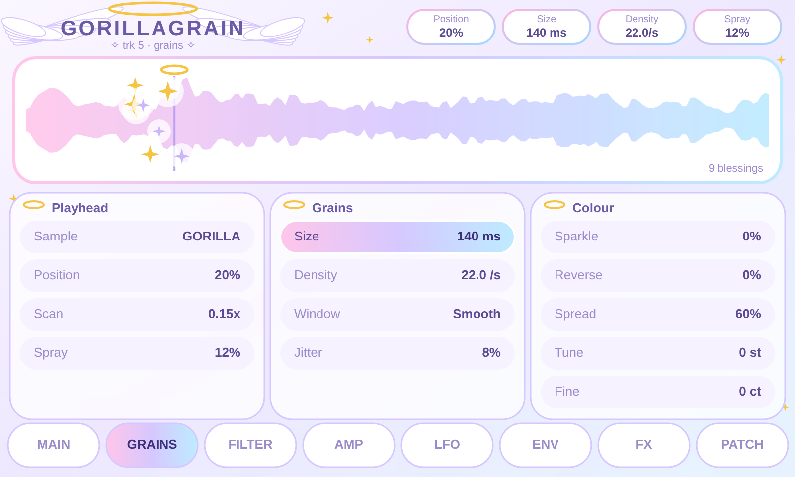

# GibGob OS design ideas (saved for later)

## Y2K cyber angelic (the user's own style name) - not used yet

Saved while choosing GORILLAGRAIN's look (night jungle won). Bring it up again
when designing the next new screen or engine.

- Light theme: pearl/lavender page (#FBF7FF -> #EEE8FF -> #E6F4FF)
- Iridescent fades pink -> lilac -> sky blue (#FFC6EA, #D6C8FF, #BDEBFF) for the
  selected box, the active tab, the waveform
- Gold halos (#F5C542 ellipse rings) over the title, panel titles and the playhead
- Feather wings either side of the title, gold and lilac four-point sparkles
- Text: #5A4A92 / #3D2F7A on white and pale lilac rows (#F6F2FF)
- Mockup source: looks_mockups.py (three looks; the third is this one)

## Singing synth with lyrics (idea, not planned yet - bring it up again later)

The user's idea (Nov 2026): a Vocaloid-style singer. Notes in the piano roll,
words typed onto the notes, intonation per note. What is possible on the Mini:
1. Formant singer (robotic, tiny, many voices) + typing syllables on notes
   (the Mini's text keyboard; lyrics kept in a small file per project, since a
   note has no spare bytes).
2. Voicebank mode like UTAU: a folder of recorded syllables (free voicebanks
   or recorded on the Mini), stitched and pitch-shifted (1-2 voices,
   tens of MB of sample memory).
3. English words to sounds with a pronunciation dictionary on the SD card
   (looked up while typing, not while playing).
Per-note expression: glide in, vibrato depth/speed, consonant length, attack.
Real Vocaloid quality / neural voices are not possible on this chip.
